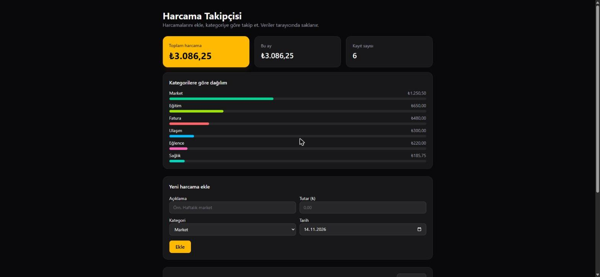
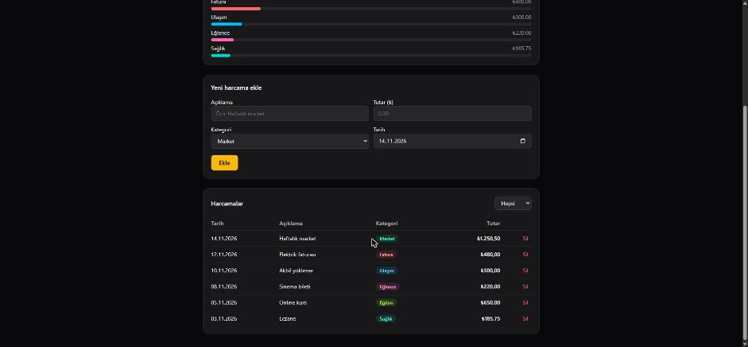

# Harcama Takipçisi

Günlük harcamalarını kaydedip kategorilere göre takip etmeni sağlayan, React ile yazılmış küçük bir web uygulaması. Veriler sunucuya gitmez, tarayıcının **LocalStorage**'ında saklanır; sayfayı yenilesen de kaybolmaz.





## Özellikler

- Açıklama, tutar, kategori ve tarih ile harcama ekleme (virgüllü tutar desteklenir: `1250,50`)
- Hatalı girişte uyarı (boş açıklama, sıfır veya geçersiz tutar)
- Üstte özet kartları: toplam harcama, bu ayın toplamı, kayıt sayısı
- Kategorilere göre renkli dağılım çubukları ve tabloda renkli kategori rozetleri
- Kategoriye göre filtreleme ve en yeni tarihe göre sıralı tablo
- Harcama silme
- Koyu tema (zinc zemin, amber vurgu); mobilde de okunabilir, duyarlı tasarım

## Kullanılan teknolojiler

- [React](https://react.dev/) 19 (Vite ile)
- [Vite](https://vite.dev/)
- [Tailwind CSS](https://tailwindcss.com/) v4
- LocalStorage (özel `useLocalStorage` hook'u)

## Kurulum

```bash
git clone https://github.com/Enessalman23/Harcama-Takip.git
cd Harcama-Takip
npm install
npm run dev
```

Tarayıcıda `http://localhost:5173` adresini aç. Üretim derlemesi için `npm run build`, derlemeyi denemek için `npm run preview` kullanılabilir.

## Proje yapısı

```
src/
├── App.jsx                  # Durum yönetimi ve sayfa düzeni
├── categories.js            # Kategori listesi, renkler, para biçimi
├── hooks/useLocalStorage.js # State'i LocalStorage ile senkron tutan hook
└── components/
    ├── SummaryCards.jsx     # Özet kartları ve kategori dağılımı
    ├── ExpenseForm.jsx      # Harcama ekleme formu ve doğrulama
    └── ExpenseTable.jsx     # Tablo, filtre ve silme
```

Veri modeli: her harcama `{ id, title, amount, category, date }` şeklinde bir nesnedir ve `harcamalar` anahtarıyla LocalStorage'da JSON olarak tutulur.

## Yapay zekanın kullanımı

Bu projeyi **Claude Code** (Anthropic) ile birlikte geliştirdim.

| Aşama | Yapay zekadan alınan yardım |
|---|---|
| Planlama | Fikrin, ekranların ve veri modelinin (`id, title, amount, category, date`) birlikte belirlenmesi |
| Kurulum | Vite + React + Tailwind v4 kurulumu ve yapılandırması |
| Geliştirme | Bileşenlerin (form, tablo, özet kartları) ve `useLocalStorage` hook'unun üretilmesi |
| Doğrulama | Uygulamanın tarayıcıda çalıştırılıp harcama ekleme ve sayfa yenilemede verinin korunmasının denenmesi |
| Dokümantasyon | README taslağının hazırlanması |

Üretilen kod çalıştırılarak denendi: derleme hatasız tamamlanıyor, harcama ekleme, toplam ve dağılım hesapları ile LocalStorage kalıcılığı tarayıcıda doğrulandı.

## Canlı demo

Canlı bağlantı yayına alındıktan sonra buraya eklenecek.
